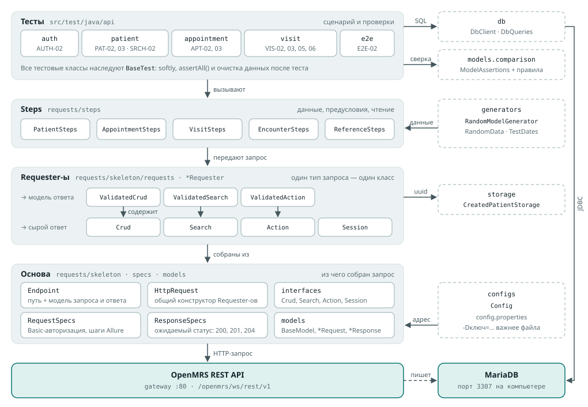

# Автотесты OpenMRS 3

Фреймворк автотестов для медицинской информационной системы OpenMRS 3 ([openmrs-distro-referenceapplication](https://github.com/openmrs/openmrs-distro-referenceapplication)).

## Стек

Java 21, Maven, JUnit 5, RestAssured, Lombok, AssertJ, Allure, JDBC (MariaDB), Docker Compose.

## Статус

В работе: каркас фреймворка и API-кейсы приоритета P0.

## Устройство фреймворка

- Тест вызывает Steps, Steps передают запрос Requester-у, Requester отправляет его в OpenMRS по `Endpoint` и спецификациям (схема ниже).
- Тестовые данные случайные (`RandomModelGenerator`), UUID справочников запрашиваются у сервера.
- Проверки — AssertJ `SoftAssertions` с шагами Allure; запрос и ответ сравниваются по правилам из `model-comparison.properties`.
- Созданные пациенты удаляются после каждого теста.
- Сквозной сценарий E2E-02 дополнительно проверяет записи в базе через JDBC.
- Приоритет кейса задаётся тегом `@Tag("P0")`; профиль `smoke` запускает кейсы P0.



Ещё схемы: [позитивный и негативный кейс](docs/positive-negative.svg) · [жизнь одного теста](docs/test-lifecycle.svg) · [проверка двойной обёрткой](docs/double-wrapper.svg).

## Запуск

Нужны Docker, JDK 21 и Maven. Без JDK и Maven тесты можно запустить в контейнере (шаг 3).

1. Поднять стенд OpenMRS (API на порту 80, база на 3307). Первый запуск долгий: OpenMRS создаёт базу.
   ```bash
   docker compose up -d
   ```
2. Запустить кейсы P0:
   ```bash
   mvn test -Psmoke
   ```
3. Или запустить те же тесты в контейнере:
   ```bash
   docker compose run --rm tests
   ```
4. Посмотреть отчёт Allure:
   ```bash
   mvn allure:serve
   ```

## Структура проекта

```text
open-mrs-testing-framework
├── docs/                          # схемы для README
├── scripts/
│   └── wait-for-stand.sh          # ожидание готовности стенда
├── src/
│   ├── main/
│   │   ├── java/
│   │   │   ├── configs/           # Config: config.properties и параметры -D
│   │   │   ├── db/                # SQL-проверки через JDBC
│   │   │   ├── generators/        # случайные данные и даты
│   │   │   ├── models/            # модели запросов и ответов
│   │   │   │   └── comparison/    # сравнение запроса с ответом
│   │   │   ├── reporting/         # шаги Allure
│   │   │   ├── requests/
│   │   │   │   ├── skeleton/      # Endpoint, интерфейсы, Requester-ы
│   │   │   │   ├── steps/         # Steps: данные, предусловия, чтение
│   │   │   │   └── storage/       # созданные пациенты для очистки
│   │   │   └── specs/             # RequestSpecs, ResponseSpecs
│   │   └── resources/
│   │       ├── config.properties
│   │       └── model-comparison.properties
│   └── test/
│       └── java/
│           ├── api/               # тесты: auth, patient, appointment, visit, e2e
│           └── base/              # BaseTest: softly и очистка данных
├── docker-compose.yml             # стенд OpenMRS и сервис tests
├── pom.xml
└── README.md
```
